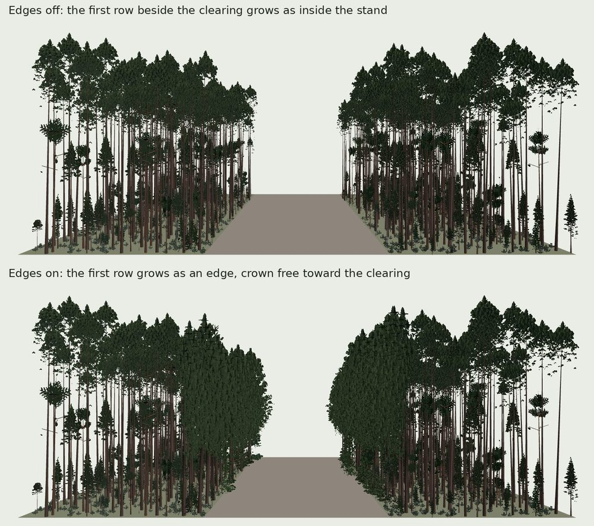

# Using PlantGen from your own code

PlantGen is a Rust library (`crates/plantgen`) and a command-line tool
(`plantc`). This page is for developers who want plants in their own
project: one at a time, or many distinct plants of a species at once.

## The stable entry point: `plantgen::api`

Every module of the crate is public, because PlantLab, `plantc` and
Project After reach into them, and they change whenever the generator
does. `plantgen::api` is the part that holds still: its items keep their
names, arguments and meaning until `api::API_VERSION` goes up, and it goes
up only when one of them changes. Build on it, not on the other modules.

What an item returns can still change in its bytes when
`GENERATOR_REVISION` goes up, as every drawing does: plants get better.
The same species, revision, options and seed give the same bytes on every
machine.

Add PlantGen to `Cargo.toml`, pinned to a revision:

```toml
[dependencies]
plantgen = { git = "https://github.com/jferments/plantgen", rev = "<commit>" }
```

One `Generator` per species does everything. Making one reads the
species' spec and draws its organs' textures once; every plant grown from
it after shares them, so keep it for as many plants as you want.

```rust
use plantgen::api::{Generator, Options, Variants};

fn main() -> Result<(), plantgen::api::Error> {
    // Every built-in species, by id.
    for id in plantgen::api::species() {
        println!("{id}");
    }

    // Yarrow, drawn as its package draws it.
    let yarrow = Generator::new("achillea-millefolium", &Options::default())?;

    // One plant: seed 1 in its typical setting at its oldest age, as glTF
    // binary files (one per level of detail) and an index.
    let plant = yarrow.grow(1)?;
    let files = yarrow.export(&plant, &Default::default())?;
    plantgen::export::write(&files, "exports".as_ref())?;

    // Fifty distinct yarrows, written as they are drawn, on every core.
    let set = yarrow.write_variants(&Variants::count(50), "yarrows".as_ref())?;
    println!("{} plants, listed in yarrows/variants.json", set.plants.len());
    Ok(())
}
```

| Item | What it does |
| --- | --- |
| `api::species()` | The ids of the built-in species |
| `Generator::new(id, &options)` | A built-in species |
| `Generator::of(&spec, &options)` | A spec of your own (`PlantSpec::from_json`), grown on its taxa's program |
| `Generator::of_in(&spec, library, &options)` | The same, from your own folder of species (`Library::from_dir`) |
| `generator.grow(seed)` | One plant in its typical setting at its oldest age |
| `generator.grow_in(environment, seed, age)` | One plant in `open`, `edge`, `interior` or `suppressed`, at any age it grows to |
| `generator.export(&plant, &settings)` | glTF binary files, one per level of detail, and their index |
| `generator.package(out)` | The species' content-addressed package, as After loads it |
| `generator.write_variants(&variants, out)` | Many plants, each written as soon as it is drawn, and `variants.json` |

`Options` chooses the quality (`Quality::STANDARD`, as packages are
built, or `Quality::DRAFT`) and the day of the year seasoned organs show. `Settings` chooses
compression (`None`, `Quantize`, `Meshopt`), which attributes to keep and
a budget (`Budget::new(triangles, bytes)` or `Budget::tiers()`), as
`plantc export`'s flags do. Start from `Options::default()`,
`Settings::default()` and `Variants::count(n)` and set the fields you
choose.

## Levels of detail: package levels or tiers

An export has four levels. By default they are the levels the plant's
package keeps, which suit After: the nearest at full detail, the farther
ones as its organs go over to cards. For a flowering herb that can fall
from hundreds of thousands of triangles to a few hundred in one step.

Tiers (`Budget::tiers()`, `plantc export --levels tiers`, and the default
for variants) space the levels instead: max is the full drawing, and high,
mid and low come as close as the plant allows to 1/8, 1/64 and 1/512 of
its triangles, kept within 20,000 to 500,000, 2,000 to 50,000 and 200 to
5,000. Between two of the package's levels, organs go over to cards a
share at a time, so a budget anywhere in between is met. A triangle budget
given with tiers caps each tier too. Measured: yarrow 1.07M, 131k, 9.9k
and 1.4k triangles (its low tier baked cards); a 60-year Douglas-fir
616M, 483k, 49k and 4.9k (which takes minutes to search on one core,
against seconds for package levels).

The low tier is the plant's baked cards where they take fewer triangles
than mid and at most 5,000: its leaves, flowers and twigs as a few dozen
cards whose pictures are baked from the whole plant, over one texture of
at most 1,024 texels a side (`Level::cards` names the tier, and the index
lists it). A lacy herb's own cards thin to nothing drawn that small, and
baked ones keep its outline. Cards that a PlantGen package turns to the
eye stand fixed in a file, as a star of three.

A plant of fleshy bodies (a cholla, a prickly pear) keeps its solid
drawing as its low tier while that is within twice the tier's most,
since cards draw its joints as scraps. Some plants cannot reach every
tier yet: a small cactus's skin and spines are drawn in big steps, so its
mid is much coarser than its share (Graham's fishhook cactus: 136k
triangles high, 394 mid, which still keeps its outline), and a pencil
cholla's thousand joints keep its mid and low at about 16k.

## Seeds and variants

Any seed grows a plant. Seed `n` is the same plant whether 5 plants or
5,000 are made beside it, so you can make more later and keep the ones you
have. The seeds a species' spec lists (`variants.seeds`, 1 always among
them) are the plants its package keeps, and seed 1 is the typical plant.
Other seeds draw the plant's parameters across the spreads its characters
give (its height, branching and the like) by the seed alone, and grow
their own branching, leaves and flowers.

A set lists each plant's seed, size (height, crown, stem diameter, leaf
area), files, bytes and triangles per level, and a fingerprint of its
bytes; `duplicates` names any seed drawn exactly as an earlier one.

## Stands over a whole map: `Fill`

For city- or region-sized scenes, never grow a plant per place. A `Fill`
develops each community's stand once at a few stand ages (which cohorts
of which species a stand of that age holds, and how much of the ground
each layer covers: `plantgen::development`, after Franklin et al. 2002),
keeps each cohort as *prototypes* (a species, seed, setting and age
each), measures them by growing each species once per seed and setting,
and lays out each tile as packed *instances* of them that any engine
draws with GPU instancing.

```rust
use plantgen::api::{Community, Fill, FillSettings, Site, StandMap, TileId};

fn main() -> Result<(), plantgen::api::Error> {
let forest = Community::from_json(r#"{"id": "fir-forest", "members": [
    {"species": "pseudotsuga-menziesii", "layer": "canopy"},
    {"species": "gaultheria-shallon"},
    {"species": "polystichum-munitum"}
]}"#)?;
let fill = Fill::new(&[forest], &FillSettings::default())?;
// Grow each prototype once (minutes for old trees), its size kept in
// "city/prototypes" so the next run grows none.
fill.measure(&[], 8, Some("city/prototypes".as_ref()))?;

// Per tile: the ground, and which community grows in each ~40 m cell.
let site = Site::flat(TileId { x: 12, y: 40 }, 240.0)?;
let stands = StandMap::uniform(240.0, 0, 120.0); // community 0, 120 years since disturbance
let plan = fill.tile(&site, &stands, 7)?;
plan.write("tiles".as_ref())?; // tiles/12_40.json and tiles/12_40.bin
// Later, in any process: the same plan from its files.
let again = plantgen::api::TilePlan::read("tiles/12_40.json".as_ref())?;
assert_eq!(again.instance_bytes(), plan.instance_bytes());
Ok(())
}
```

### What a caller may rely on (`API_VERSION` 7)

`Fill` is part of the stable API from `API_VERSION` 7. Everything below
holds until the version goes up; `tests/fill_api.rs` holds the fill to
it, calling it as you would, through `plantgen::api` alone.

- **Names.** Every item a fill takes or gives is in `plantgen::api`:
  `Community`, `Member`, `Layer`, `Origin`, `Fill`, `FillSettings`,
  `Site`, `SiteFactors`, `FieldTile`, `CrackPlant`, `TileId`,
  `StandMap`, `StandCell`, `TilePlan`, `Instance`, `WallClip`, `Cover`,
  `CoverKind`, `Floor`, `FloorMoss`, `Log`, `LogShape`, `CanopyCell`,
  `TileStats`, `LayerCover`, `Prototype`, `PrototypeKey`,
  `PrototypeFiles`, `PrototypePackage`, `read_prototypes` and the
  constants `INSTANCE_SCHEMA`, `INSTANCE_BYTES`, `PROTOTYPES_FILE`,
  `STAND_AGES`, `STAND_CELL_M`, `STAND_SCALE`, `TRIANGLE_PIXELS` and
  `CLIMBER_SPACING_M`. The rest of `plantgen::fill`
  (`with_colonists`, `tile_crowns`, `cells_per_layout` and the like) is
  not, and changes with the generator.
- **What you build and what you read.** The inputs you make yourself
  (`TileId`, `StandMap`, `StandCell`, `Member`, `Community`,
  `CrackPlant`, `Instance`) keep their fields; a field added to one
  raises `API_VERSION`. What a fill makes (`TilePlan`, `Prototype`,
  `PrototypeFiles`, `PrototypePackage`, `Cover`, `Floor`, `FloorMoss`,
  `Log`, `CanopyCell`, `TileStats`, `LayerCover`) is non-exhaustive: read
  its fields, and make one only through its constructor (`Cover::of`,
  `Log::new`), so fields can be added beside them. `FillSettings` and
  `Site` start from `FillSettings::default()` and `Site::flat`,
  `Site::from_heightfield` or `Site::from_field`.
- **What changes with `GENERATOR_REVISION`, not the version.** Which
  plants a tile holds, where, how big, and every byte of every file: the
  fill models stands better with each revision. The same communities (in
  the same order), settings, site, stand map, seed and revision give the
  same bytes in every file, on every machine and thread count.
- **Prototypes are known by their key.** `PrototypeKey` (and its file
  stem, `<species>-<setting>-<seed>-<age>y`) is the same plant, the same
  bytes, in any fill at the same revision and options; cache prototype
  files by stem and revision. `Instance::prototype` is an index into
  `fill.prototypes()`, which holds for the fill that wrote it: the same
  communities in the same order and the same settings. A fill with
  another community or stand age numbers its prototypes otherwise.
- **The files** (written by `TilePlan::write`, `Fill::write_prototypes`,
  `TilePlan::glb` and `TilePlan::glb_cells`, or by `plantc fill`):

  | File | Form | Read it with |
  | --- | --- | --- |
  | `tiles/X_Y.json` | JSON, `schema` = `INSTANCE_SCHEMA` (4): `generator_revision`, `tile` (`x`, `y`), `day`, `tile_m`, `cell_m`, `cols`, `instance_bytes` (32), `instances` (how many), `instances_file`, and per stand cell row by row from the south-west `cover` and `canopy`; `stats`, `logs`, `floor_mosses` | `TilePlan::read(path)` (with the `.bin`) |
  | `tiles/X_Y.bin` | the packed instances back to back, 32 bytes each (below) | `Instance::from_bytes`, or any language by the layout |
  | `prototypes/prototypes.json` | JSON, `schema` = `INSTANCE_SCHEMA`, `generator_revision`, `prototypes`: each `index`, `key`, `age_years`, `layer`, `plant` (`seed`, `stem`, `size`, `levels`: `level`, `file`, `bytes`, `triangles`; `fingerprint`, SHA-256 of the levels' bytes) and `parts` (`region`, `levels`). It lists every prototype the fill wrote into the folder, not only the last call's | `read_prototypes(dir)` |
  | `prototypes/<stem>-lodN.glb`, `<stem>-<part>-lodN.glb` | glTF 2.0 binary, a plant at a level (0 nearest), as `Generator::export` writes it; +Y up, the plant's foot at the origin | any glTF reader |
  | `tiles/X_Y.glb` | glTF 2.0 binary, every plant of the tile at one level with `EXT_mesh_gpu_instancing`, root at the tile's south-west corner (+X east, +Y up, -Z north) | any glTF reader (meshopt files: see below) |
  | `tiles/X_Y/cells.json`, `tiles/X_Y/c<col>_<row>-lod<N>.glb` | the index (`format` `plantgen-tile-cells`, `schema` 1) and each cell's file, as the whole tile's | JSON, any glTF reader |

  A tile's GLB files place each plant exactly where its packed instance
  does, so a tile read back from its files (`TilePlan::read`,
  `read_prototypes`) draws the same bytes as the plan the fill made. A
  reader refuses a file of a schema it does not know rather than
  misreading it; the schema goes up whenever a file's form changes.
  The `<stem>.size.json` and `<stem>.prototype.json` beside the
  prototypes are the fill's own caches, not part of the contract.
- **Not built yet.** A far stand-in for a whole tile (one card or
  height field per tile, for kilometres off) is not in the API; the
  per-cell `canopy` raster is what a host draws far forest from today.

- **Stands that develop.** A stand cell is drawn at the stand age
  (`FillSettings::stand_ages`, 10 to 640 years unless chosen) nearest its
  years since disturbance, its first cohort's trees grown to that age. A
  young stand's trees grow as in the open until half its years to closure
  (17 years for Douglas-fir's 500-year lifespan), then as in a stand.
  Once the crowns close (35 years) the cohort's dominants overtop part
  of it: those trees grow as overtopped trees do and stand in the middle
  layer, two fifths of them suppressed, grown as at half the stand's
  years, in the lower layer; the shade-intolerant among them die out
  through maturation. From a fifth of the pioneers' lifespan
  shade-tolerant trees establish under them, fewer of the older, and
  stand in whichever layer their height puts them. Each layer covers
  what western Oregon's wet conifer inventory plots find (McIntosh, Gray
  and Garman 2009, PNW-GTR-794): in a closed young stand the upper trees
  70%, the middle and lower trees 27% together, shrubs 45% and herbs
  28%; in old growth 45%, 63%, 50% and 15%. Shrubs and herbs fill their
  layers where enough light reaches them, herbs beneath shrubs in their
  shade, and herbs take 90% of a meadow where no tree suits. How many
  stems a cell holds follows from the crowns, so a stand of narrow crowns
  holds more than one of wide ones.
- **Measuring the layers.** `fill.layer_cover(&plan)` (`LayerCover`)
  measures a filled tile as inventory crews measure a stand: trees 1.4 m
  or taller in upper, middle and lower layers (thirds of the tallest
  tree's height, as the fill lays the layers out), each layer's
  crowns seen from above and counted once, their stems and mean heights,
  and the shrubs and placed herbs beneath. `plantc fill` prints it, so a
  fill can be set beside plot data.
- **Edges.** A stand's first row of trees beside open ground (a bare
  cell, or a stand whose canopy stands under half as tall: a clearcut or
  a young stand beside an old one) grows as an `edge`, its crown free
  toward the opening and turned to face it (`FillSettings::edges`, on by
  default). A tree is in the first row when its stem stands within its
  crown's width of the cell's open side. `fill.tile` does not know the
  cells past the tile's sides, so it grows no edge there;
  `fill.tile_among(&site, &stands, &outside, seed)` takes them from
  `outside(col, row)` (the neighbouring tiles' maps), and a tile filled
  whole or in quarters then places the same plants.

  
- **Site-aware.** Each cell reads the site factors at its middle
  (`Site::site_factors_at`: moisture, heat load, elevation, slope); each
  species' share follows how well its niche suits them, and a site no
  tree suits opens toward woodland. Each plant stands only where
  `Site::plantable_at` lets it (none in a building or on sound pavement,
  a crack's share on broken pavement). `Site::from_field` reads both from
  a site field (`docs/sites/SITE-FIELD.md`).
- **Fast over a city.** Each community, stand age, site class and cell
  size is laid out once as a wrapping stand tile and stamped over every
  cell that shares it, turned and shifted by the cell's (or its block's)
  place in the world, from four layouts each. `Fill::new` reads its
  species on every core and makes a species' `Generator` only when a
  prototype of it is grown, drawn or written, so a fill whose sizes are
  all kept starts in seconds (3 s for Olympia's 45 species, from 34).
  `TilePlan::stats` gives the stand numbers to check against plots:
  stems and trees (5 cm or more at breast height) per hectare, basal
  area, canopy cover and leaf area index, and edge trees per hectare.
  `FillSettings::herbs = false` leaves herbs to the ground cover raster
  for hosts that draw ground cover their own way.
- **Pure and local.** A tile's plan depends only on the fill's
  communities, the site, the stand map, the seed and
  `GENERATOR_REVISION`. Its draws are keyed by each stand cell's place in
  the world, so neighbouring tiles meet without a seam and any tile can
  be filled alone, on any thread (`Fill` is `Send + Sync`).
- **Many communities per tile.** The `StandMap` gives each cell a
  community (or none: pavement, building, water) and the years since it
  was disturbed or abandoned, and may give the ground's `moisture` (0 dry
  to 1 saturated) where the caller knows it better than the ground's
  shape: a coarse height model reads a creek's bank or a lake's shore as
  level ground (0.5), too dry for red alder or Pacific willow, so a city
  that maps its water gives its bank cells their own (Olympia's: 0.95 at
  the water's edge to 0.7 at 15 m). A city's map changes every few metres (a
  yard, a verge, a bed by a house), finer than a crown: a cell under
  `STAND_CELL_M` (40 m) reads its window of one stand tile laid out for
  its block of cells about 40 m across (`fill::cells_per_layout`), the
  site's factors read at the block's middle. Crowns are laid out whole,
  and the cells of one stand in a block continue one pattern: a 40 m
  tile mapped in 4 m cells of one stand places the very plants one 40 m
  cell does, and a bare 4 m strip through it takes out only the plants
  whose stems stand in it. `fill.tile` lays out every stand tile a tile
  needs on every core before it places a plant, and keeps them for the
  next tile. Over a square kilometre of Olympia, Washington (four 512 m
  tiles, 4 m cells mapped from ESA WorldCover, Overture Maps and SRTM),
  laying out the stand tiles takes about 22 s once, and each tile then
  places its trees and shrubs in 0.04 to 0.1 s on 4 cores (about 30,000
  a square kilometre there, where a sixth of the cells are forest or
  yard trees). How that city's mesh, materials and stand map were made
  is in [sites/DEVELOPERS.md](sites/DEVELOPERS.md), "A real city tile".
- **Prototypes** (`fill.prototypes()`) are keyed by species, seed,
  setting and age (`PrototypeKey::age_tenths`, its files named
  `<species>-<setting>-<seed>-<age>y`). `fill.measure(which, threads,
  cache)` sizes them before `fill.tile` (which says so when one is not);
  `fill.write_prototypes` exports them and measures what it writes;
  `fill.grow_prototype(i)` grows one to export with its species'
  `Generator`. A city shares one prototype set.
- **Ingrowth beneath the canopy.** A shade-tolerant tree that came up
  under its stand's crowns (hemlock, cedar and yew in an old Douglas-fir
  forest) grows beneath its community's canopy, as tall as the tallest of
  its trees commonly grows (`PrototypeKey::beneath_m`, its stem's setting
  `beneath60m`; `Generator::grow_ages_beneath`): its like around it as in a
  stand, and over it a canopy whose shade leaves 17% of the sky's light at
  the ground (`spec::UNDERSTOREY_DEPTH`), more toward the canopy. A
  western hemlock that came up 120 years ago beneath Wind River's 60 m
  canopy is 19.7 m tall, where a stand of hemlocks its age is 43.6 m. Only
  conifers grow so for now (`fill::BENEATH_PROGRAMS`): grown there, a
  broadleaf sheds every leaf, so a broadleaf's ingrowth grows as in a
  stand. From 300 years the pioneers' deaths open gaps, and the share of
  an ingrowth cohort that a gap opened over grows on as in a stand of its
  like (`development::Cohort::released`), at the age its size matches
  (`development::RELEASE_CATCH_UP`: its years beneath the canopy count a
  third): at 500 years, a quarter of Wind River's 240-year hemlocks stand
  as 120-year trees in a stand, 43.6 m tall.
- **Prototypes as packages.** A host that draws packages (Project
  After does, with motion and card tiers) takes `fill.packages(which)`:
  one `PrototypePackage` per species, setting and seed, its `spec`
  holding that one variant with a keyframe at each of its prototypes'
  ages. Build it as any package (`package::Inputs::new(&spec, &quality)`,
  then `with_motion` or `with_cards` as you like), and draw prototype
  `prototypes[k].0` as the package's variant at keyframe
  `prototypes[k].1`: the same plant, at the same size, as `fill.measure`
  grows. A tree come up beneath a canopy keeps the canopy as its
  variant's neighbourhood, and an old tree grows on past its spec's
  years. A climber grown at a wall's foot grows at the foot of the same
  6 m wall in its package (`spec.variants.wall_m`, `export::WALL_M`),
  only to its prototype's age; draw it cut back to the wall it stands at
  by its instance's `extra` (`WallClip`). In the package's frame, as in
  the prototype's, the wall's face is the plane z = -0.3, facing +z.
  `plantc fill ... --packages DIR` builds them and lists in
  `DIR/packages.json` which package and keyframe draws each prototype,
  with `wall_m` for a wall climber's.
- **Parts of tall plants.** A prototype 6 m or taller is also written in
  parts (`FillSettings::parts`, on by default): its bole under the crown
  and its crown in up to four bands sized by its own height, each limb
  whole in the part where it leaves the stem, so no seam cuts through
  foliage. Each part has a file per tier (`STEM-<part>-lodN.glb`, listed
  in `prototypes.json` under `parts` with its box), and a level's parts
  together draw exactly the level. A caller draws each part at the tier
  its own distance asks for: from the ground a tall tree's top is coarse
  and its lower limbs fine, and from a roof at crown height the top is
  fine. The instance stays the same; only which file draws each part
  changes. `Generator::export_parts(&plant, &settings, &crown_regions(&plant.size))`
  does the same for any one plant.
- **Instances** pack into 32 bytes, little-endian: u32 prototype, f32 x3
  position (east, north, up, metres from the tile's south-west corner),
  i16 x4 snorm rotation quaternion (z up), f16 scale, u16 age in tenths
  of a year, i8 x2 tint (lightness, hue shift), u16 extra (a climber's
  cut back to its wall, `WallClip::from_extra`; 0 for any other plant).
  `Instance::from_bytes` reads them back. Schema 4 (`INSTANCE_SCHEMA`):
  the instances are as in schema 3, and the tile JSON gained the forest
  floor and the logs (below) and the day it shows (`day`); in schema 2 a
  climber's extra was its wall's top alone, in decimetres.
- **The day of the year** a tile shows is its settings' day
  (`FillSettings::options.day`, 196, mid-July, unless chosen; the
  plan's and the JSON's `day`). Each prototype is drawn on it, so a
  deciduous tree, shrub or vine stands bare in winter, puts out pale
  leaves in spring and turns in autumn as its leaves' year
  (`appearance.organs.leaf.leafing`) says. The stand is the same every
  day: only what shows changes. A herb that dies back
  (`development::Shoots`, from its `leaf_habit`, `life_span` and leaf
  and flowering months) is placed only while its shoots are up; herbs of
  every season are laid out together, those up in summer covering what
  the plots give, so a spring herb keeps its place among them. A bare
  crown lets more light through (`development::BARE_CROWN_LIGHT`,
  against 0.1 in full leaf, from light measured under a leafless and a
  leafy deciduous canopy), so a herb whose shoots stand in spring is
  judged by the light under a still bare canopy. `stats.crowns_in_leaf`
  is the share of tree crowns in leaf that day. Prototypes a write kept
  are drawn again for a new day where their species' looks change with
  the year.
- **Ground cover and far canopy** come per stand cell in the plan
  (`cover`: kind and fraction; `canopy`: height, cover, colour), for
  hosts that draw ground cover and far forest with their own systems.
  The canopy's colour is its trees' foliage in full light, linear RGB,
  each species' weighed by its crowns' area, so a maple stand reads
  lighter than a fir one from afar. On the tile's day a deciduous crown's
  leaves are tinted as they unfold and turn, and a bare crown shows its
  twigs: its cover counts as the light they stop, so a bare maple stand
  hides less than half the ground and reads grey-brown.
- **The forest floor** comes per stand cell too (`cover[k].floor`,
  `Floor`): the shares of the ground under litter, moss and logs (side
  by side, together at most 1, the rest bare soil) and under herbs (over
  them). Moss grows where crowns close, the ground is moist and few
  shrubs, herbs or broad leaves cover it (`development::ground_moss`,
  fitted to the Puget Trough's plots); litter lies under the crowns over
  the rest. `floor.mosses` names up to three moss genera with their
  shares of the cell's moss, by their index in the plan's
  `floor_mosses` (the JSON's `floor_mosses`): the library's mosses that
  fit a shaded, moist floor (`development::floor_mosses`), the fastest
  spreading leading after a disturbance and the deepest wefts later, as
  Hylocomium does in old growth. A host can tint its ground with each
  genus's `mosses::MossKind::far_colour`.
  Where fires keep a stand open (a community's `fire_years`),
  `floor.lichen` is the share under Cladonia lichen mats between the
  grasses, beside the moss: none until 5 years after a fire, 13% of the
  ground from 20 years (`development::prairie_lichen`, from Calabria et
  al. 2016's five south Puget Sound prairies), less under closing crowns
  and shrubs; left out of the JSON where there is none. The lichens
  themselves are library taxa (`lichens::kinds`: the reindeer lichens,
  Cladonia subgenus Cladina, first): a host tints the ground with
  `LichenKind::far_colour` from afar and draws `lichens::draw_mat` near.
- **Logs** lie on a natural stand's floor (`TilePlan::logs`, the JSON's
  `logs`; none in a planted or kept stand, and on cleared ground only
  those its own trees drop): each with the species it
  fell from, the floor under its middle (as an instance's position),
  the way its axis runs from its large end (`yaw`, radians from east), how
  far its small end rises (`pitch`) and its shape
  (`deadwood::Shape`: length, both ends' widths, decay class 1-5,
  seed). How many, how large and how rotted follow the age of the stand,
  as 196 Douglas-fir plots measured them (Spies, Franklin and Thomas
  1988: about 600 a hectare covering a tenth of the floor in young
  stands, fewest in mature ones). Draw each with your own meshes, or
  with `deadwood::draw(&log.shape, appearance, level)`, a mesh in the
  log's own frame (axis along +x, up +y, the floor at y = 0): its
  species' bark while it keeps bark (alpha minus the radius, as a plant's
  bark), bare and mossy wood as it rots, oval and sunk in class V.
  `plantc logs --render logs.png` draws the five classes side by side.
  `plantc fill ... --render` draws the logs and the floor; `--cut 2.5`
  leaves out everything above 2.5 m to show it.

From the command line, `plantc fill` does the same (`--ages` chooses the
stand ages, `--herbs no` leaves herbs to the ground cover, `--edges no`
grows no edges) and also
measures every prototype and exports each one the tile places (both
cached by key, so the next tile only grows and draws the ones it adds):

```bash
./target/release/plantc fill meadow.json --tile 2,3 --tile-m 240 --seed 5 \
    --compress meshopt --out city
# city/tiles/2_3.json, city/tiles/2_3.bin, city/prototypes/prototypes.json and GLBs
```

`docs/examples/communities/wind-river.json` is the old-growth
Douglas-fir and western hemlock forest of the Wind River plot (Shaw et al.
2004): fill it at `--years 500 --site 0.5,1,370,5` to check a stand
against the plot. The `olympia-*.json` communities beside it cover a
lowland Puget Sound city, from its forest and creeks to its yards, beds,
lots, verges and lawns; the folder's `README.md` says which ground each
belongs on, which are planted, and how they were checked.

`docs/examples/fill-viewer.html` is an example caller with no PlantGen
code: copy it into the `--out` folder, serve that folder
(`python3 -m http.server`) and open `fill-viewer.html?tile=2_3`. It draws
every plant with one three.js `InstancedMesh` per prototype part and
tier, each part's tier by how big it looks from the eye (`&lod=N` fixes
it, `&parts=no` draws plants whole, `&view=ground` or `&view=roof`
stands the eye under or among the crowns). On a 40 m tile of 60-year
Douglas-firs, parts drew 1.48 M triangles from the ground where whole
plants drew 2.50 M, and 1.67 M where 2.33 M from crown height.

**A tile as one glTF file.** For a host that only reads glTF (Blender,
Godot, Unity's glTFast, a three.js `GLTFLoader`), `plantc fill ... --glb 3`
(or `TilePlan::glb(&prototypes, dir, level, meshopt)`) also writes
`tiles/X_Y.glb`: each prototype the tile places, at one level for the
whole tile, stored once, and a node per prototype mesh that draws every
plant using it with `EXT_mesh_gpu_instancing`. Its root node sits at the
tile's south-west corner (+X east, +Y up, -Z north), so tiles laid side by
side meet. A 40 m tile of an 80-year Douglas-fir stand with yarrow
(1,047 plants) is 0.7 MiB at the low tier and 1.1 MiB at the mid tier
with `--compress meshopt`, which three.js, glTFast and Blender 5.2 read;
Blender 4.5 LTS and Godot do not read meshopt, so for them write
`--compress quantize` (0.9 and 3.6 MiB), or turn meshopt output into such
files with
`plantc unpack DIR --out DIR2` (or `plantgen::gltf::unpack`), which
undoes the compression in every `.glb` of a fill's folder and copies the
rest. It draws
the whole tile at one level; a caller that wants detail by distance reads
the packed instances and the prototype files as above.

**A tile in cells, each at the detail its distance asks for.** A host
that reads only glTF can still draw near plants fine and far ones coarse:
`plantc fill ... --glb-cells 1,2,3 --cell-m 20` (or
`TilePlan::glb_cells(&prototypes, dir, cell_m, &levels, meshopt)`) cuts
the tile into cells `cell_m` across and writes each as one such file at
every level listed, `tiles/X_Y/c<col>_<row>-lod<N>.glb`, each with its
root at its cell's south-west corner, and an index, `tiles/X_Y/cells.json`.
For each cell and level the index gives `pixel_m`, the widest a pixel
may be where it falls, metres, before the level is enough: its triangles
then cover four pixels each (`TRIANGLE_PIXELS`) over the cell's most
demanding plant's height times breadth. A host draws a cell at the
coarsest level whose `pixel_m` is at most `distance x 2 tan(fov_y / 2) /
pixels_high` at the cell's nearest point; `from_m` is that distance for a
camera 1080 pixels high and 60 degrees across. A host short of
triangles lets each cover more pixels: at `k` times as many, every
`pixel_m` and `from_m` shrinks by the square root of `k`. In 20 m cells of an
80-year Douglas-fir stand, the high level is enough from 9 m, mid from
31 m and the cards from 112 m. `docs/examples/cells-viewer.html` draws a
tile this way with stock three.js: a 120 m tile seen from the ground drew
8 cells at the high level, 25 at mid and 3 as cards. glTF's own level-of-detail extension,
`MSFT_lod`, is read by Babylon.js and UnityGLTF but by Blender and
three.js only through add-ons, so the cells do not rely on it.

**A whole tile from afar.** Past the distance at which a tile's cards
are enough, a tile still holds thousands of plants; games draw forest that
far as a surface (Bruneton and Neyret 2012 draw it as a z-field, the
canopy's height over the terrain, with its shading in maps; Serious Sam 4
splats its farthest forest into the terrain). `Fill::canopy(&plan, &site,
&FarSettings::default())` (or `plantc fill ... --far 0.5`, written as
`tiles/X_Y-far.glb` and `tiles/X_Y-far.json`) makes one such stand-in from
the tile's own plants, drawn at the farthest level as the cells draw them:

- a picture of the tile from straight above (`FarSettings::texel_m`, half
  a metre unless chosen), its colour under even light with the cover in
  alpha, and a sky-view map (glTF's occlusion map) that darkens the
  spaces between crowns;
- a height field of the crowns' tops, a vertex every `grid_m` (2 m). Plants
  1.4 m or taller make it (`shell_least_m`); the herbs and shrubs beneath
  are in the picture only. A space between crowns narrower than the stand
  is tall (or than `gap_m`, 5 m) is bridged: the surface runs over it no
  steeper than 60 degrees and the picture shows what lies down there, as
  dark as the sky it sees lets it be. Wider openings drop to the ground,
  so a clearing or a road shows the host's ground;
- skirts down to the ground along the tile's sides, showing each side as
  seen level from outside (trunks under crowns), so a stand's edge at the
  side of a tile reads from afar and no crack opens between neighbours.

Its root sits at the tile's south-west corner (+X east, +Y up, -Z north)
like the tile's other files. The scene's extras (and the JSON) give its
`from_m`: the distance from which a texel is no wider than a pixel for a
camera 1080 pixels high and 60 degrees across (468 m at half-metre texels),
so a host draws the cells nearer and this farther. A 120 m tile of an
80-year Douglas-fir stand is 7,680 triangles and 0.57 MiB, where its level-3
cells are 214 MiB uncompressed; at a kilometre the cells' cards are thinner
than a pixel and read as speckles, while the stand-in stays a closed
forest. `Fill::canopy_among(&plan, &site, &[&neighbour, ...], &settings)`
also draws the neighbours' crowns that reach across its sides, so two
neighbours baked with each other agree along the side they share. Growing
the prototypes takes the time (two to four minutes for that tile on four threads);
a `Fill` keeps what it drew, so the next tile of the same fill grows none
again.

**Checked in Blender** (2026-11-06, Blender 4.5.9 LTS and 5.2.3, File >
Import > glTF 2.0 with its defaults): a 40 m tile of Douglas-fir, bigleaf
maple and yarrow written with `--compress none` and `--compress
quantize` (the tile file, every cell file at levels 1 to 3 and every
prototype file) imports with every triangle the file holds and every
card texture. Blender 5.2 imports `--compress meshopt` files whole as
well; Blender 4.5 refuses them ("Extension EXT_meshopt_compression is
not available on this addon version"), and after `plantc unpack` imports
them whole. Since 2026-11-08 CI checks this on every change to the code
that writes these files, and on `main`: the `blender` job imports a fixed
set of every kind of export (tiers, variants, a tile's file, cells and
prototypes, unpacked meshopt, moss) in Blender 4.5 LTS and fails on any
lost triangle, image or vertex colour (`tools/blender/README.md`, which
also says how to run it yourself).

Standing dead trees (snags) are not placed yet; fallen logs are
(`TilePlan::logs`, above). A climber member (layer `climber`) has one
prototype per seed grown at the foot of a 6 m brick wall
(`Generator::grow_ages_on_wall`, the stem's setting `wall`), to the first
age its spec measures it that tall. On a tile over a site field
(`Site::from_field`) it stands at the feet of walls and fences: one per
`CLIMBER_SPACING_M` (3 m) of climbable foot at abundance 1, times the
open share of the ground it roots in, its face turned onto the wall's,
and not at a host whose foot stands above the ground (a gable end, a
window) or that is too low to climb (a curb). The instance's `extra` is
its `WallClip`: in the prototype's frame (+y up, its wall along x, the
wall's face at z = -0.3), the host's top above its foot (`top_m`) and how
far its run of wall goes along -x and +x (`back_m`, `ahead_m`; infinite
past 6.2 m). A renderer drops every triangle and card that
`WallClip::keeps` refuses, so the climber stops at its wall's top and
ends. On a height-field tile there is nothing to climb and none stands.

A community member names a `species` and may give a `layer` (canopy,
subcanopy, shrub, herb, ground, climber) that keeps it to that layer
in place of its niche's, the `environments` it grows in (interior, edge,
open, suppressed; all four when left out) and an `abundance` (a share
against the others, 1 when left out). A species without a niche needs
its layer, suits every site and stands half tolerant of shade (`plantc
fill` names such members). A community is `"origin": "natural"` unless
it says `"planted"` or `"cleared"`: a natural stand develops as after a
fire (its first trees by their intolerance of shade, the tolerant ones
coming up beneath them later), while a planted one (a yard's, a street's
or a park's kept trees) holds each tree in proportion to its abundance
from the start, with nothing coming up beneath. A cleared one (a vacant
lot, a building site, a road's or railway's edge) develops as a natural
one does on ground no forest left anything on: its floor holds only the
logs its own trees drop. It gives no density: how many stems a cell holds comes from
the fill, from the site and the stand's age, not from the caller.

Any plant can be grown past its spec's years to its old ages (doubling
past its last keyframe up to its lifespan; `PlantSpec::old_ages`), and
`Generator::grow_ages_in(environment, seed, &ages)` keeps several ages
from one growth, as a stand's cohorts of one species and seed are.

Each instance's `rotation` carries its yaw and its lean together.
`Instance::lean(yaw, [east, north])` builds it, with the lean in metres
per metre up, so a plant on a slope or reaching for a gap stands as the
fill grew it with no extra field to read.

## Moss on a host's walls and roofs: `plantgen::mosses`

Moss is a surface layer over a site mesh, not plant instances. Grow a
cover once for a building or a tile, keep it as JSON, and draw it at the
level the view needs. The full guide is
[docs/sites/MOSS.md](sites/MOSS.md).

```rust
use plantgen::library::Library;
use plantgen::math::Vec3;
use plantgen::mosses::{self, Detail, DrawOptions, MossSettings};

// `site` is a SiteMesh, for example from plantgen::api::site_mesh.
let mut kinds = mosses::kinds(Library::builtin())?;
// Keep only the region's genera (as a site document's `mosses` list does).
kinds.retain(|k| ["Dicranoweisia", "Rosulabryum", "Niphotrichum"].contains(&k.genus.as_str()));
let cover = mosses::grow(&site, &kinds, &MossSettings { years: 30, ..Default::default() });
let json = cover.to_json()?; // and MossCover::from_json to read it back

// Triangles: patches far off, shells, or shoots close up. `day` (1-365)
// draws each genus's capsules young, ripe, spent or gone for the season;
// None draws them all ripe.
let mesh = cover.draw(&site, &DrawOptions { detail: Detail::Shell, day: Some(120.0), ..Default::default() });

// No triangles: colour and coverage (0-1) to bake into the host's texture.
let tint = cover.tint(0.4); // hydration, 0 dry to 1 wet
if let Some((rgb, coverage)) = tint.at(Vec3::new(4.3, 2.5, -0.8), Vec3::Y) {
    // blend rgb over the roof's texel by coverage
}
```

`MossCover::census` gives each genus's colonies and area. Growing the
test wall and shed for 30 years takes about 30 s; drawing a whole
building at shell level is under a million triangles.

## From the command line

```bash
cargo build --release
./target/release/plantc variants achillea-millefolium --count 50
./target/release/plantc variants pseudotsuga-menziesii --count 20 --age 30 \
    --compress meshopt --out firs
```

The first writes 50 yarrows into `variants/achillea-millefolium/`: for
each, `STEM-lod0.glb` to `STEM-lod3.glb` and `STEM.json`, where STEM is
`<species>-<environment>-<seed>-<age>y`, and `variants.json` listing them.
`plantc help` lists every flag: `--first-seed`, `--env`, `--age`, `--day`,
`--quality`, `--threads`, and `plantc export`'s compression, attribute,
budget and `--levels` flags (variants draw tiers unless `--levels package`).

Measured on a 4-core cloud machine (2026-11-01): 6 yarrows at 6 years in
7 s; 4 Douglas-firs at 60 years in 82 s.

The files are glTF 2.0 that need no PlantGen code. Uncompressed and
quantized files open in Blender, Godot, Unity (glTFast) and three.js;
`--compress meshopt` files need a viewer with meshopt decoding, such as
three.js or Blender 5.2; `plantc unpack` turns them into quantized
files Blender 4.5 reads. The max level is drawn at full detail, which for a flowering
herb or an old tree is a lot of triangles: use `--compress` and the
farther tiers, or a budget, for real-time scenes.
