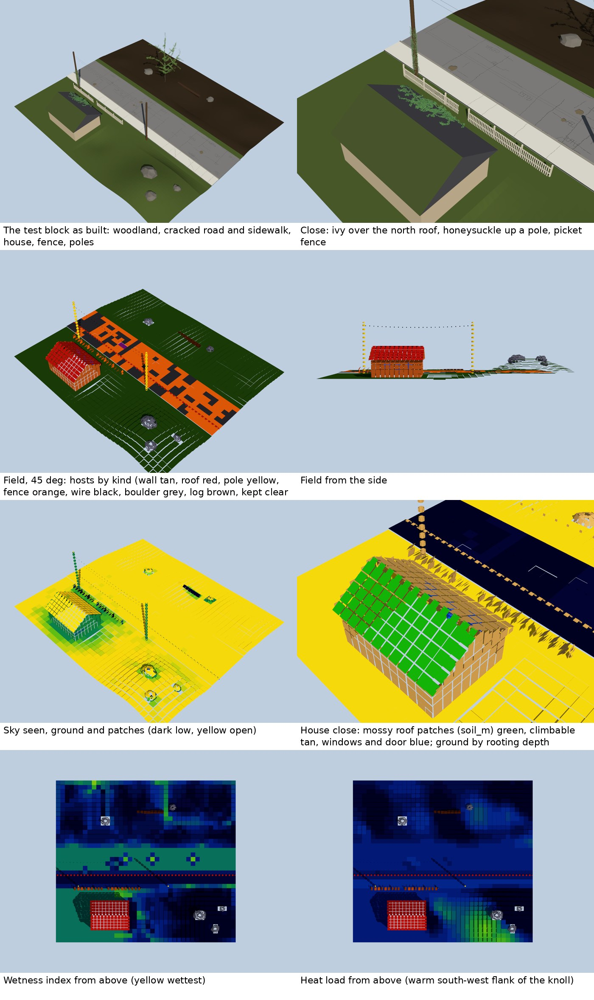
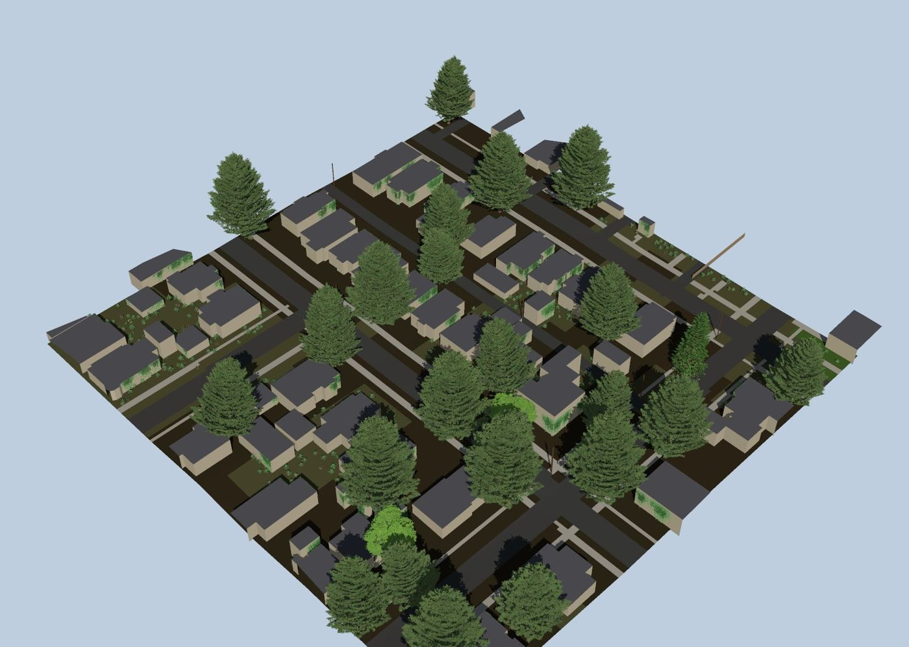

# Sites: a developer's guide

How PlantGen grows plants on a mesh someone hands it (a terrain, a
building, a street), and how it measures a whole tile of such a site once
so that stands of plants can be laid over it fast. This guide is for
whoever changes this code. The file formats are in
[SITE-FIELD.md](SITE-FIELD.md) (the site field) and in `plantc help`
(the site document).



The test block (`docs/sites/make_block.py`) and its field: the block as
built and close up with a few plants; hosts by kind from 45° and from the
side (wall tan, roof red, pole yellow, fence orange, wire black, boulder
grey, log brown, kept clear blue; ground soil green, paved grey, cracked
orange); sky seen; the house close, with the mossy roof's patches that
carry soil green; wetness and heat load from above.

## What lives where

| Piece | Where | What it does |
| --- | --- | --- |
| Site mesh | `crates/plantgen/src/site.rs` | `SiteMesh`: triangles, a `Surface` per triangle (material, `thin_m`, `climb`, `clear`, `soil_m`, `reaction`), and column indexes for vertical lines and rays. Cuts what one plant grows in. |
| Pavement | `crates/plantgen/src/pavement.rs` | `CrackTile` (what a host hands over: slab, cracks, holes, soil in them) and `Pavement` (the tile rasterised; footing, classify, wear, openings). |
| Pavement colonisation | `crates/plantgen/src/succession.rs` | Which plants come up by themselves in the cracks, year by year, without growing each one. |
| Site field | `crates/plantgen/src/site_field.rs` | `SiteField`: one tile measured once (ground grid, hosts and patches, crack sites) for stands and other hosts. |
| Stand fill's ground | `crates/plantgen/src/fill.rs` | `Site::from_field`: a fill tile over a site field, where plants may stand (`plantable_at`), what their niches read (`site_factors_at`, moisture from the wetness index by `moisture_from_wetness`), how much soil their roots find (`soil_ratio_at`), and the plants that came up in its cracks (`with_colonists`). See SITE-FIELD.md, "Reading it for stands". |
| Moss | `crates/plantgen/src/mosses.rs` | `mosses::grow`: moss colonies over a site's surfaces, year by year, into a `MossCover`; `MossCover::draw` (patch, shell, shoots, near) and `MossCover::tint` (no triangles). See [MOSS.md](MOSS.md). |
| Host API | `crates/plantgen/src/api.rs` | `SiteInput`, `site_mesh`, `site_field`, `site_material`: the same from plain arrays, no files. |
| CLI | `apps/plantc/src/main.rs` | `plantc site` (grow and draw plants on a site), `plantc cracks` (colonisation), `plantc field` (measure a field), `plantc moss` (grow and draw moss). |
| Tests | `crates/plantgen/tests/sites.rs` | Sites, pavements, colonisation, and the `field` module. Unit tests of the tracer are in `site_field.rs`. |
| Moss tests | `crates/plantgen/tests/mosses.rs` | Genera, placement, determinism, levels, tint. |
| Test sites | `docs/sites/` | `garden`, `house`, `road` and `block` (each kind of host in one 40 x 36 m area), and the scripts that make them; `moss-wall` and `moss-shakes` (a garden wall and a shed) for moss, made by `make_moss_wall.py`. |

## How the data flows

```
mesh + material table + crack tiles
        |
        v
    SiteMesh (+ Pavement per tile)
        |                                   |
        | per plant (slow, exact)           | per tile, once (fast)
        v                                   v
  substrate_round, host_round,        site_field::build -> SiteField
  rooting, cut_back                         |
        |                                   +--> stands: species by site,
        v                                   |    laid out by crown (stand
  a conditions document that                |    work, plantgen#330)
  growth reads as it reads a preset         +--> fill: instances over the
                                            |    tile (Library API, #327)
                                            +--> colonisation of cracks
```

Growing one plant on a site cuts a grid round its foot from the mesh,
which takes time per plant. A city tile holds far too many plants for
that, so stand placement reads only the field and grows nothing per
plant; the exact cut is kept for the few plants a viewer comes close to.

## Frames and units

- Metres throughout. Growth's frame: +Y up, +X east, -Z north. With
  `z_up` the input's +Z is up and its +Y north, and the mesh is turned on
  the way in.
- A field's cells are indexed row by row from `origin`, the tile's low
  corner less the margin. Cell `i` is in column `i % columns` and row
  `i / columns`.
- `fill` in the Library API measures east and north from the tile's
  corner, so its north is the field's -z.
- Heat load: the field stores McCune and Keon's index (0.706 on level
  ground at 45°). A niche's `heat_load` range is relative to level ground
  (1.0). Read `SiteField::relative_heat_load` or `site_factors`, never the
  raw list, when you compare against a niche.

## The site mesh

- `columns` indexes the solid triangles by 1 m column, `columns_all` all of
  them, thin parts too. Vertical lines (`crossings`, `footing`) use the
  first; rays and wall searches use the second.
- Inside or outside: a vertical ray from the sky crosses closed solids an
  odd number of times above a point inside one. Faces pressed together (a
  wall's top under its roof) cancel. Thin parts never count.
- `footing` prefers the highest soil under a point, then the highest face
  that faces up. Under a paved tile, the tile answers instead.
- `rooting` gives the depth of rootable soil down to the next surface.

## Building a site field

`site_field::build` runs these steps. All are linear in the cells or the
patches.

1. **Ground.** For each cell centre: footing, the inside-solid test (a
   cell inside a boulder or a house has no ground), material, under-roof.
   A separate `terrain` list keeps the footing even inside solids, so that
   host faces below the ground can be dropped.
2. **Slope, aspect, heat load** from the neighbours' heights. Steps of
   more than two cells' height (a curb, a wall) are not slope.
3. **Wetness**: D8 flow, cells in falling order, ln(a / tan β).
4. **Rooting and open share**: from the crack tiles on paved cells, from
   the next surface below on soil.
5. **Sky and walls**, on every core: 24 cosine-weighted rays per cell
   through the `Tracer`, and a ring search for the nearest upright face
   and the nearest face kept clear.
6. **Crack sites**: each opening patch of each tile, linked to its cell.
7. **Hosts and patches**, on every core, a part at a time: faces joined by
   shared edges into parts, low woody and thin parts within 0.12 m joined
   (`join_near`, so a fence is one part), each part classified, then cut
   into hosts and binned into patches by (u, v, side). Their sky goes
   through the tracer too. Only the parts that reach the field's grid are
   kept, so a mesh made for a whole town can be measured a tile at a time:
   over a 1 km Olympia mesh a 512 m tile's field took 11 s, not 40.

### How a part is classified

In this order, first match wins (`surfaces`):

1. All kept clear: a `wall` (a window or a door), its patches `clear`.
2. Wood, bark or thin, on the ground, 0.3 to 3 m tall, at most 0.35 m
   thick, longer than tall: a `fence`, split into bays by u.
3. Not all thin, at most 0.8 m across and three times as tall: a `pole`.
4. All thin: `thin` (wires).
5. Rock: a `boulder`.
6. Wood or bark lower than half its length: a `log`.
7. Otherwise a building: split into faces where it turns more than about
   25°, each a `wall`, `roof` or `overhang` by its normal.

### Adding a host kind

1. Add the variant to `HostKind` (its JSON name is the snake_case name).
2. Add its rule to the classification in `surfaces`, at the right place in
   the order, and pick a builder: `planar_host` (one face),
   `planar_host_along` (one long host, then `split_bays`), or `round_host`
   (u round an upright axis).
3. Say what `u` runs along in the table in SITE-FIELD.md.
4. Give it a colour in `docs/sites/field_view.py` (`KINDS`).
5. Put one in `docs/sites/make_block.py` and add a test to the `field`
   module of `tests/sites.rs`.
6. A new kind is an addition: `SITE_FIELD_VERSION` stays. Renaming or
   changing the meaning of a field or kind raises it.

### Adding a ground value

Add the list to `Ground`, compute it in `build`, round it as its
neighbours are (so the bytes stay stable), document it in SITE-FIELD.md,
and test it. A list added beside the others leaves the version as it is.

## Same inputs, same bytes

A field is cached by hosts, so it must not depend on the machine:

- Parallel work goes through `spread`, which returns results in index
  order (`cores::map` underneath) and borrows only idle cores
  (`cores::Lease`). Never collect from threads in finishing order.
- Maps whose order reaches the output are `BTreeMap`s. A `HashMap` is fine
  only for lookups.
- Every float is rounded before it is written (heights to 1 mm, slope to
  0.1°, sky to 0.001).
- Hosts are numbered per part from 0 and offset afterwards in the parts'
  order.

## Speed

On the test block tiled 12 x 12 (480 x 432 m, 1.9 million triangles,
199,000 ground cells, 143,000 patches) a field takes about 6 s on 4 cores;
loading the 68 MB OBJ takes 2 s more. The first version took 298 s on a
fifth of that. What made the difference, so it is not lost:

- **The tracer** (`Tracer` in `site_field.rs`) copies each column's
  triangles into one flat array over the field and its reach, with each
  column's top. A ray walks the columns it crosses in order (Amanatides
  and Woo 1987), each once, and tests a column's triangles only where the
  ray is not already above its top, so rays climb out of a site after a
  few columns. It is exact: a unit test checks it against testing every
  triangle.
- **No work per ray that grows with the mesh.** The first version called
  `SiteMesh::bounds()` (a pass over every vertex) for every ray. Anything
  per ray or per cell must be constant or per column.
- **The wall search** goes ring by ring outward and stops once a ring lies
  farther than the nearest wall and window found, reading a list of only
  the faces that can count.
- Where the time goes now: mostly the ground's sky rays and the host
  parts (patch binning samples each face at a quarter of a patch).
- **A field reads only its own parts.** Parts whose faces all miss the
  field's grid are dropped before they are classified, so one mesh made
  for a whole town serves every tile cut from it. Before, each 512 m tile
  of a 1 km mesh classified the whole mesh (33 to 43 s a tile; now 11 s).

## A real city tile

How a host gets from a city's open data to a filled tile. This was done
for Olympia, Washington: four 512 m tiles of ground, roads and buildings,
4 m stand cells, seven communities. The fill's timings are in
[LIBRARY-API.md](../LIBRARY-API.md), "Many communities per tile".



A 160 m window of the South Capitol neighbourhood at detail level 2.
Ground from SRTM; buildings, roads and land use from Overture Maps
(© OpenStreetMap contributors, Overture Maps Foundation); tree cover
from ESA WorldCover 2021. Herbs are left to the host's ground cover.

1. **The mesh.** Ground as a grid (1 m here, from SRTM's 30 m heights),
   buildings as prisms from their footprints and heights (or floors times
   3 m), roads as ribbons as wide as their class with sidewalks beside
   them, and poles and fences where the data has them. Use the frame
   above (x east, +Y up, z = -north), with heights relative to the lowest
   ground, and give the mesh the field's margin (20 m), no more: parts in
   a wider margin are measured as hosts the field never reads.
2. **Materials.** In the site document, paving (asphalt, concrete,
   paths, ballast) must be `rock`: a `built` face that looks up is a host,
   so `built` roads become roofs (half a million patches on one tile).
   Walls and roofs are `built`, fences and poles `wood`, and lawn,
   forest floor and bare ground `soil` with their depth.
3. **Water.** Leave out streams the data marks as underground or in a
   culvert: drawn on the surface, they grow a strip of riverside alder
   down a street.
4. **The stand map.** One community index (or none) and the years since
   disturbance for each 4 m cell, rows from the south. Olympia's rules,
   first match wins: under 15% soil or inside a building, none; within
   15 m of water, alder by water (40 years under tree cover, else 10);
   tree cover of a half or more, yard trees (80 years) near a house or on
   residential land, else lowland forest (80); within 4 m of a house, a
   garden bed (10); bare, construction or by a railway, a lot (10); a
   third or more paved, a verge (1); otherwise lawn (1).
5. **Yard trees grow open.** Give a yard community's members
   `"environments": ["open", "edge"]`. As stand members they grow as in a
   closed stand, tall and narrow, and bury the houses in forest. Keep
   thicket-formers (rowan, hawthorn) out of garden beds, where a bed's
   cover makes thousands of them a hectare.
6. **Filling.** One `Fill` for the whole city. For each tile, build its
   field once from the town's mesh over the tile's box
   (`site_field::build`), then
   `fill.tile_among(&site, &stands, &outside, seed)` with the
   neighbouring tiles' cells as `outside`. The first tile lays out the
   stand tiles the city needs, and the rest reuse them. `plantc fill
   <community.json>... --stands stands.json --field SITE.json --corner
   X,Z --ages 1,10,40,80 --herbs no` does one tile.
7. **Drawing it.** `--render` draws every plant at one level, so above
   about 10 million triangles it needs more than 15 GB. Draw a window
   (a 160 m tile of the same mesh) at level 2, or level 1 closer in.

## Tests and test sites

```bash
cargo test --release -p plantgen --test sites field   # the field
cargo test --release -p plantgen --lib site_field     # the tracer
cargo test --release -p plantgen --test fill on_a_site_field  # a fill on a field
python3 docs/sites/make_block.py                      # rewrites block.*
./target/release/plantc field docs/sites/block.json --out /tmp/block-field.json \
  --tile -20,-18,20,18 --margin 0
python3 docs/sites/field_view.py /tmp/block-field.json /tmp/block-view --ground material
./target/release/plantc site /tmp/block-view/view.json --out /tmp/block-field.png \
  --view oblique --size 1400 --quality draft --focus 0,0,0 --span 44
```

To fill the block with stands and draw it (about two minutes on four
cores at draft quality; the communities and stand map are written by
`make_block_fill.py`):

```bash
python3 docs/sites/make_block_fill.py
./target/release/plantc fill docs/sites/block-fill/woodland.json \
  docs/sites/block-fill/yard.json --tile 0,0 --tile-m 40 --corner -20,18 \
  --field docs/sites/block.json --stands docs/sites/block-fill/stands.json \
  --ages 8,60 --seeds 2 --cracks 10 --moss 30 --prototypes none \
  --out /tmp/block-fill --render /tmp/block-fill.png --size 1600
```

`--moss 30` grows thirty years of moss over the tile and draws it with
the plants (MOSS.md, "Into the site fill"); leave it out for the plants
alone.

Each plant is drawn at the coarsest level its size in the image allows
(each triangle about four pixels, as a cell index chooses), so a whole
60-year block draws in about 8 M triangles; `--level` sets the finest.
Add `--focus X,Y,Z --span M --level 0` for a close view: the house is
about `-8,2.5,12` (span 14), the most broken stretch of street
`-2.5,0,0` (span 7).

The sheet at the top of this guide is made from these same commands by
`skills/sites-work/make_field_sheet.py` in the project's private agent
notes (`jferments/plantgen-claude`).

`field_view.py` colours the ground by `sky`, `wetness`, `heat`, `rooting`
or `material`, and the patches by `kind`, `sky` or `soil`. To test speed,
tile `block.obj` into a larger OBJ (offset each copy by 40 m in x and 36 m
in z) and run `plantc field` on it; the field reports its own time.

## Pitfalls met so far

- One host per picket: pickets, rails and wires must be joined
  (`join_near`) before a fence is classified.
- Glass and doors are thin and look like fences: kept-clear parts are
  classified first.
- Wires strung between poles joined with them into a "log": joining is
  limited to low parts, and a fence must stand on the ground.
- Fence bays split by triangle centre gave wrong boxes: split by patch u.
- Cells inside a boulder or a house read as ground under a roof: the
  inside-solid parity test (taking the nearest crossing instead broke
  where two crossings tie).
- Host faces below the ground came back once cells inside solids had no
  height: hence the separate `terrain` list.
- Cells in a pothole saw no sky because the mesh under the tile blocked
  them: rays in a paved cell start at the tile's top.
- A patch centre round a pole fell inside the pole and saw no sky: patches
  round a round host are binned by facing (8 compass sectors, up, down),
  with at least 4 bins round it.
- Two modules once both claimed `crate::succession` (crack colonisation
  and stand development); check names against open pull requests before
  adding a module.
